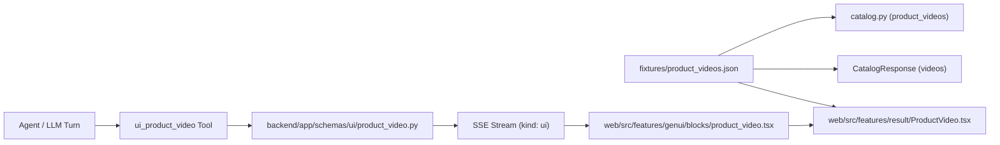

# Takomo Product Videos & Influencer Mappings (Issue #4)

> **Reference documentation for video embeds, influencer setups ("In The Bag" / WITB), and media streams across the Takomo iron lineup.**
> This document details the datasets in [`fixtures/product_videos.json`](../fixtures/product_videos.json), the backend UI schema in [`backend/app/schemas/ui/product_video.py`](../backend/app/schemas/ui/product_video.py), the catalog integration in [`backend/app/fitting/catalog.py`](../backend/app/fitting/catalog.py), and the frontend components in [`web/src/features/result/ProductVideo.tsx`](../web/src/features/result/ProductVideo.tsx) and [`web/src/features/genui/blocks/product_video.tsx`](../web/src/features/genui/blocks/product_video.tsx).

---

## 1. Architecture & Data Flow

1. **Static Source of Truth**:
   - [`fixtures/product_videos.json`](../fixtures/product_videos.json) is keyed by the 5 `HeadSlug` entries (`"101-mkii"`, `"201-mkii"`, `"201t-mkii"`, `"301-cb"`, `"301-mb"`).
   - Under each head slug, it defines `headline`, `tagline`, default `youtube_id`, `hero_mp4_url` / `hero_hls_url`, verified `influencers`, and the complete list of verified `videos` categorized by `kind` (`official`, `influencer_witb`, `independent_review`).

2. **Backend Catalog & Schemas**:
   - `backend/app/fitting/catalog.py`: `product_videos()` loads `fixtures/product_videos.json`. It attaches the head's video payload to `list_products("heads")` and exports the full map on `CatalogResponse.videos`.
   - `backend/app/schemas/ui/product_video.py`: Declares `class ProductVideo(UIBlockBase)` with `type: Literal["product_video"] = "product_video"` and `head: HeadSlug`. It auto-registers the `ui_product_video` agent tool via autodiscovery in `backend/app/schemas/ui/__init__.py`.
   - `fixtures/ui/product_video.json`: Golden UI block fixture: `{"type": "product_video", "head": "201t-mkii"}`.

3. **Frontend Presentation**:
   - `web/src/features/result/ProductVideo.tsx`: Accepts `{ head: HeadSlug; className?: string }`.
     - **Influencer Chips ("Who Plays This")**: Displays ambassadors (Grant Horvat, Fat Perez, Bryan Bros, Bobby Fairways, Josh Zerkaa, etc.) with one-click switching to their WITB video.
     - **Active Video Player**: Responsive 16:9 embedded player using `youtube-nocookie.com/embed/${id}?rel=0` or native `<video>` for direct 4K/HD Shopify CDN MP4 reels.
     - **Category Filter Tabs & Video Cards**: Allows browsing between Official Takomo Testing, In The Bag (WITB), and Independent Reviews. Automatically resets to the featured video whenever the `head` prop changes.
   - `web/src/features/genui/blocks/product_video.tsx`: Gen-UI block exporting `{ type: 'product_video', Component }` for the studio stream renderer.

---

## 2. Influencer & Ambassador Bag Mappings (WITB)

The table below details verified influencer setups and endorsements across each Takomo iron head:

| Iron Model | Influencer / Creator | Channel / Handle | Takomo Role / Notable Achievement | Verified Video ID | Featured Video Title |
|---|---|---|---|---|---|
| **101-mkii** | **Robbie Berger (Bobby Fairways)** | Bob Does Sports (`@Bobdoessports`) | Official Partner & Ambassador (games 101 MKII for max forgiveness) | `yjUTQcY1rt8` | Bobby Fairways 👌 Takomos In The Bag |
| **101-mkii** | **Josh Zerkaa** | Big Wedge Golf (`@BigWedgeGolf`) | High-handicapper gamer ("I love how forgiving they are") | `e2ykbK5WQxc` | BIG WEDGE is Team Takomo! |
| **101-mkii** | **Joey Cold Cuts** | Bob Does Sports (`@Bobdoessports`) | Official Partner (games hollow-body Takomo irons) | `uuUYFbWtfrE` | Joey Cold Cuts⚡️Takomos In The Bag |
| **101-mkii** | **Sabrina Andolpho** | Sabrina Andolpho (`@sabrinaandolpho`) | Ambassador ("Even if swing is off, still hitting greens") | `JiBbYBVB-j8` | Takomo Trackman Challenge: Sabrina Andolpho |
| **201-mkii** | **Robbie Berger (Bobby Fairways)** | Bob Does Sports (`@Bobdoessports`) | Initial Takomo bag build & gamer iron | `0Jl9h0AgrME` | IT'S OFFICIAL! Bob Does Sports x Takomo |
| **201-mkii** | **Seb on Golf** | Big Wedge Golf (`@BigWedgeGolf`) | Gamer ("really like how they feel off face with high launch") | `e2ykbK5WQxc` | BIG WEDGE is Team Takomo! |
| **201-mkii** | **Claire Hogle** | Claire Hogle (`@clairehogle`) | Official Ambassador (tested & showcased 201 MKII setup) | `Oat4C8_86AI` | Takomos In The Bag @ClaireHogle |
| **201t-mkii** | **Bryan Bros (Wesley & George)** | Bryan Bros Golf (`@BryanBrosGolf`) | Featured 201T as Iron of the Year contender | `PrQfDxQy-xw` | Takomo 201T - Iron Of The Year @BryanBrosGolf |
| **201t-mkii** | **Josh Mayer (JMay)** | Josh Mayer Golf (`@joshmayergolf`) | Ambassador & gamer (games 201T MKII + 101U) | `0fx_DFSuiIw` | Is 201T MKII good for you? @BryanBrosGolf |
| **301-cb** | **Grant Horvat** | Grant Horvat Golfs (`@granthorvatgolf`) | **Won 2024 PGA Tour Creator Classic** at East Lake with 301 CBs | `du8z9ch1lVk` | Grant's Updated Takomo Setup |
| **301-cb** | **Fat Perez (Nick Stubbe)** | Bob Does Sports (`@Bobdoessports`) | BDS star ball-striker (games 301 CB for forged stability) | `WJ6LRFlKAt8` | FAT PEREZ ⛳️ Takomos In The Bag @Bobdoessports |
| **301-cb** | **Mason Nutt (Busta)** | BustaJack Golf (`@BustaJackGolf`) | BustaJack co-founder (custom built 301 CB set) | `U9BC7sFuHBE` | Mason's got some SICK Takomos! |
| **301-cb** | **Taco Golf (Tae Koh)** | Taco Golf (`@tacogolf`) | NZ golf creator (games 301 CB irons + 101U) | `qzj_8OuHHuI` | THIS is our Takomo Setup |
| **301-cb** | **Golf Sidekick (Matt)** | Golf Sidekick (`@GolfSidekick`) | Ambassador (games 301 CB forged irons) | `CFEmfFqYuYU` | Tim is MIA. Golf SideKick runs our YouTube |
| **301-cb** | **Eric Cogorno** | Eric Cogorno Golf (`@ericcogorno`) | PGA Teaching Professional ("Love look, feel, and versatility") | `wHWkdH1P-EA` | Which one will he choose? 201 vs 301 CB |
| **301-mb** | **Wesley Bryan** | Bryan Bros Golf (`@BryanBrosGolf`) | **PGA Tour Winner (RBC Heritage)** (played 301 MB on PGA Tour) | `HVVIjMVly9g` | Our Brand New Irons! \| Bryan Bros WITB |
| **301-mb** | **George Bryan** | Bryan Bros Golf (`@BryanBrosGolf`) | PGA Tour / Korn Ferry Tour competitor (games 301 combo set) | `HVVIjMVly9g` | Our Brand New Irons! \| Bryan Bros WITB |
| **301-mb** | **Luke Kwon** | Luke Kwon Golf (`@LukeKwonGolf`) | Pro golfer & creator (games 301 combo set with 301 MB short irons) | `dCuo81QMw-I` | Ok fine I'll tell the truth about Takomo Golf |
| **301-mb** | **Cole Lantz (MadJack)** | BustaJack Golf (`@BustaJackGolf`) | BustaJack co-founder (games 301 MB short irons) | `xh87z2V71rE` | This is SAVAGE. |
| **301-mb** | **Sam Heung Min** | Sam Heung Min Golf (`@samheungmin`) | Ambassador (games 301 Combo set with 301 MB blades) | `qzj_8OuHHuI` | THIS is our Takomo Setup |

---

## 3. Verified YouTube Video Index by Head

### 101-mkii (Game Improvement)
- `AP7MiQJfaXI` (official) — *Takomo 101 MKII Irons Tested at Average Swing Speeds* (Takomo Golf)
- `gIGyfUl_nqQ` (official) — *NEW Takomo 101 MKII (TrackMan Testing)* (Takomo Golf)
- `eeaH5b9yVcA` (official) — *OG 101 vs Takomo 101 MKII* (Takomo Golf)
- `w00qCbcIhy4` (official) — *NEW Takomo Game Improvement Irons! On Course Testing!* (Takomo Golf)
- `yjUTQcY1rt8` (influencer_witb) — *Bobby Fairways 👌 Takomos In The Bag @Bobdoessports* (Takomo Golf)
- `e2ykbK5WQxc` (influencer_witb) — *BIG WEDGE is Team Takomo!* (Takomo Golf)
- `uuUYFbWtfrE` (influencer_witb) — *Joey Cold Cuts⚡️Takomos In The Bag @Bobdoessports* (Takomo Golf)
- `JiBbYBVB-j8` (influencer_witb) — *Takomo Trackman Challenge: Sabrina Andolpho* (Takomo Golf)
- `cq1hwDrzJh0` (independent_review) — *NEW for 2026! - Takomo 101 MKII Review* (Lets Play Thru)
- `k0SCeWHSCng` (independent_review) — *Takomo 101 MK2 — My Honest Thoughts After Testing Them* (Mistah Short Hitter)
- `1asUKCW7Hkc` (independent_review) — *9 Holes with Takomo 101 MK2 + Short Hitter Opinion* (Mistah Short Hitter)
- `YmNzv6wU0jo` (independent_review) — *BEST BUDGET IRONS AROUND? \| Takomo 101 MK2 Irons* (AskGolfNut)
- `GNV5SNMk7Ak` (independent_review) — *Takomo (2026) has done What the Golf Industry Doesn’t Want* (Alex Elliott Reviews)
- `rt026pmHraQ` (independent_review) — *THE TRUTH: Takomo v TaylorMade v Titleist* (H.I.T GOLF / Rick Shiels)

### 201-mkii (Forged Players Distance)
- `OmCEpyfiquo` (official) — *THIS Iron Replaces 101T (Takomo 201 MKII)* (Takomo Golf)
- `U4dlPoubLls` (official) — *The New 201 Irons: Head-to-Head!* (Takomo Golf)
- `QhRIHDfxIgk` (official) — *Hype? Or Actually Good?* (Takomo Golf)
- `x_E9CTheL8s` (official) — *HOW FAR Does an Average Golfer Hit Takomo 201 MKII Irons?* (Takomo Golf)
- `0Jl9h0AgrME` (influencer_witb) — *IT'S OFFICIAL! Bob Does Sports x Takomo* (Takomo Golf)
- `Oat4C8_86AI` (influencer_witb) — *Takomos In The Bag @ClaireHogle* (Takomo Golf)
- `ht-B-xodRiY` (independent_review) — *The NEW Takomo 201 Mk2 vs TaylorMade P790 - HUGE RESULTS!* (James Robinson Golf)
- `A73oqqIH5O8` (independent_review) — *These are the Best Irons Takomo Has Ever Made* (Lets Play Thru)
- `rtSlPVUmacM` (independent_review) — *Takomo 201 MKII tested by a 9-handicap GOLFER* (Golf Mates)
- `HNmoeHpICWg` (independent_review) — *TAKING ON THE TAYLORMADE P790 \| Takomo 201MK2 Irons 2026 Review* (AskGolfNut)
- `aA0x1TSC5s4` (independent_review) — *2026 Takomo Irons - Almost Perfect...* (H.I.T GOLF / Rick Shiels)
- `I-GBkdS57JY` (independent_review) — *Have I Been Using The WRONG IRONS!? Brutal Takomo Comparison!* (James Robinson Golf)

### 201t-mkii (Compact Players Distance)
- `_47TA2zYHUs` (official) — *Give me some NUMBERS! (TrackMan Testing 201T MKII)* (Takomo Golf)
- `R6MJLKNWJyc` (official) — *Can You Really Play the Takomo 201T MKII at Average Swing Speeds?* (Takomo Golf)
- `EmGluKEZc3o` (official) — *OG 201 vs Takomo 201T MKII* (Takomo Golf)
- `U4dlPoubLls` (official) — *The New 201 Irons: Head-to-Head!* (Takomo Golf)
- `PrQfDxQy-xw` (influencer_witb) — *Takomo 201T - Iron Of The Year @BryanBrosGolf* (Takomo Golf)
- `0fx_DFSuiIw` (influencer_witb) — *Is 201T MKII good for you? @BryanBrosGolf* (Takomo Golf)
- `Z9li4WW_lws` (independent_review) — *An Honest On Course Test of Takomo 201T MKII Irons* (Lets Play Thru)
- `0dP0XHD8Umg` (independent_review) — *Takomo 201T MK2 — The Truth After Testing Them* (Mistah Short Hitter)
- `vvN70h3p8w0` (independent_review) — *Are These the Hottest Irons of 2026? - Takomo 201T MkII* (CK Golf)

### 301-cb (Forged Cavity Back)
- `zjkhwg4W7XY` (official) — *Takomo Iron 301 CB / MB explained* (Takomo Golf)
- `3osmksYaopM` (official) — *I won the Creator Classic using these Irons! @GrantHorvatGolfs* (Takomo Golf)
- `wHWkdH1P-EA` (official) — *Which one will he choose? 201 vs 301 CB @GrantHorvatGolfs* (Takomo Golf)
- `du8z9ch1lVk` (influencer_witb) — *Grant's Updated Takomo Setup* (Takomo Golf)
- `WJ6LRFlKAt8` (influencer_witb) — *FAT PEREZ ⛳️ Takomos In The Bag @Bobdoessports* (Takomo Golf)
- `U9BC7sFuHBE` (influencer_witb) — *Mason's got some SICK Takomos!* (Takomo Golf)
- `qzj_8OuHHuI` (influencer_witb) — *THIS is our Takomo Setup (Luke Kwon, Sam Heung Min, Taco Golf)* (Takomo Golf)
- `CFEmfFqYuYU` (influencer_witb) — *Tim is MIA. Golf SideKick runs our YouTube - Irons Only* (Takomo Golf)
- `gKkM1z9rnv4` (independent_review) — *Maybe the BEST VALUE IRONS in the world (blown away!) \| Takomo 301CB irons* (Golfalot)
- `eQczQ4zbEV8` (independent_review) — *Are The Takomo 301 CB Irons Worth The Hype? (Honest Review)* (Bogey Book Golf)
- `N9_YifU6pos` (independent_review) — *Takomo 301 CB Irons: 3 Months In The Bag… Was The Gamble Worth It?* (Golf Mad Dad)
- `1beMZDyjdjM` (independent_review) — *Takomo 301 CB vs Takomo 101 \| Which Should You Buy?* (Golf Mad Dad)
- `V8l_DLgJDgk` (independent_review) — *Takomo 301CB Review \| Can Irons Beat Titleist & Mizuno?* (Good Ole Days Golf)
- `otQOwG1Z9u8` (independent_review) — *We Laughed at These Irons… Until We Hit Them – Takomo 201 vs 301 MB vs 301 CB Irons* (Embers Golf)
- `dorklm4M7MQ` (independent_review) — *The CHEAP Irons That Are KILLING The Big Brands!* (Matt Fryer Golf)

### 301-mb (Forged Muscle Back Blade)
- `zjkhwg4W7XY` (official) — *Takomo Iron 301 CB / MB explained* (Takomo Golf)
- `HVVIjMVly9g` (influencer_witb) — *Our Brand New Irons! \| Bryan Bros WITB* (Bryan Bros Golf)
- `qzj_8OuHHuI` (influencer_witb) — *THIS is our Takomo Setup (Luke Kwon, Sam Heung Min, Taco Golf)* (Takomo Golf)
- `dCuo81QMw-I` (influencer_witb) — *Ok fine I'll tell the truth about Takomo Golf Clubs* (Luke Kwon Golf)
- `xh87z2V71rE` (influencer_witb) — *This is SAVAGE.* (Takomo Golf x BustaJack)
- `1fRmV1vWQsA` (independent_review) — *Could Takomo DESTROY the big brands?* (H.I.T GOLF / Rick Shiels)
- `rRDPyxosp_Y` (independent_review) — *I play Golf with all Takomo clubs - my BRUTALLY HONEST Opinion* (Rick Shiels Golf)
- `QhQGDjpfBMg` (independent_review) — *Takomo 301 MB Irons: SO MUCH CLUB FOR SO LITTLE MONEY* (Andrew Jensen Golf)
- `QdfOEJzbCjU` (independent_review) — *Are The Takomo 301 MB Irons Worth The Hype? (Honest Review)* (Bogey Book Golf)
- `rIjujtigQZA` (independent_review) — *Takomo Iron Range Review \| 101, 201, 201T & 301 MB Tested* (Golfshake.com)
- `eEqmN5q-f5M` (independent_review) — *Takomo 301 Irons Review — 5 Best Cheap New Forged Iron* (Budget Tee Box)
- `UopdSuHqYEg` (independent_review) — *Does He REGRET Buying TAKOMO Irons!? - 12 MONTH HONEST REVIEW!* (James Robinson Golf)
- `-vxgr_zM5OU` (independent_review) — *The Golf Clubs to BEAT in 2024!* (Alex Etches Golf)

---

## 4. Direct Media Streams (Shopify CDN & The Forge Mux)

In addition to YouTube embeds, high-definition direct media streams were discovered and cataloged:

### 101 MKII Shopify CDN Direct Video Streams
- **Desktop 720p 4.5Mbps MP4**:
  `https://takomogolf.com/cdn/shop/videos/c/vp/c94104610c894f34befa1049d12135b8/c94104610c894f34befa1049d12135b8.HD-720p-4.5Mbps-84973612.mp4?v=0`
- **Desktop HLS Stream (`.m3u8`)**:
  `https://takomogolf.com/cdn/shop/videos/c/vp/c94104610c894f34befa1049d12135b8/c94104610c894f34befa1049d12135b8.m3u8?v=0`
- **Mobile 480p 1.5Mbps MP4**:
  `https://takomogolf.com/cdn/shop/videos/c/vp/bc7e9fd2aa7242cb9a2fcdc2aa362497/bc7e9fd2aa7242cb9a2fcdc2aa362497.SD-480p-1.5Mbps-84973609.mp4?v=0`
- **Poster Image**:
  `https://takomogolf.com/cdn/shop/files/101_MKII_Wow_Wide.jpg?v=1770240581&width=1500`

### The Forge Mux Video Stream
- **Playback ID**: `EDwGa8Y400U1XFw2R5ttBFgqX00h9xGDS6eQcMIbwEY004`
- **Stream URL (HLS)**: `https://stream.mux.com/EDwGa8Y400U1XFw2R5ttBFgqX00h9xGDS6eQcMIbwEY004.m3u8`
- **Thumbnail URL**: `https://image.mux.com/EDwGa8Y400U1XFw2R5ttBFgqX00h9xGDS6eQcMIbwEY004/thumbnail.jpg`
- **Origin**: `https://forge.takomogolf.com/clinic`, `/news`, `/vault`

---

## 5. Embed & CSP Verification

- **L14 Approval**: Takomo product videos and YouTube embeds are explicitly approved in `AGENTS.md` L14.
- **Privacy-Enhanced Mode**: Embeds use `https://www.youtube-nocookie.com/embed/${id}?rel=0`.
- **Playability**: 100% of the YouTube IDs indexed above were verified via YouTube oEmbed API (`200 OK`) and confirmed embeddable without region gates.
- **Content Security Policy (CSP)**: Compatible with `SecurityHeadersMiddleware` (`frame-src https://www.youtube-nocookie.com; media-src 'self' https://takomogolf.com https://stream.mux.com; img-src 'self' https://img.youtube.com https://image.mux.com https://takomogolf.com;`).
